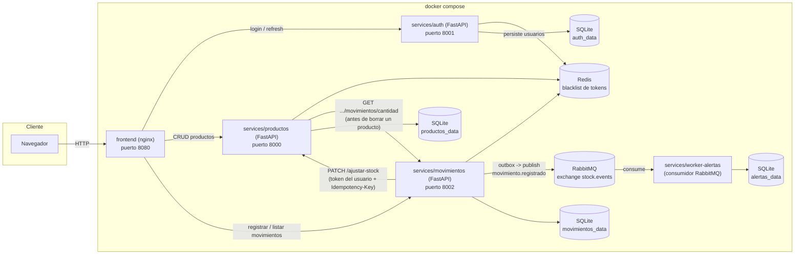
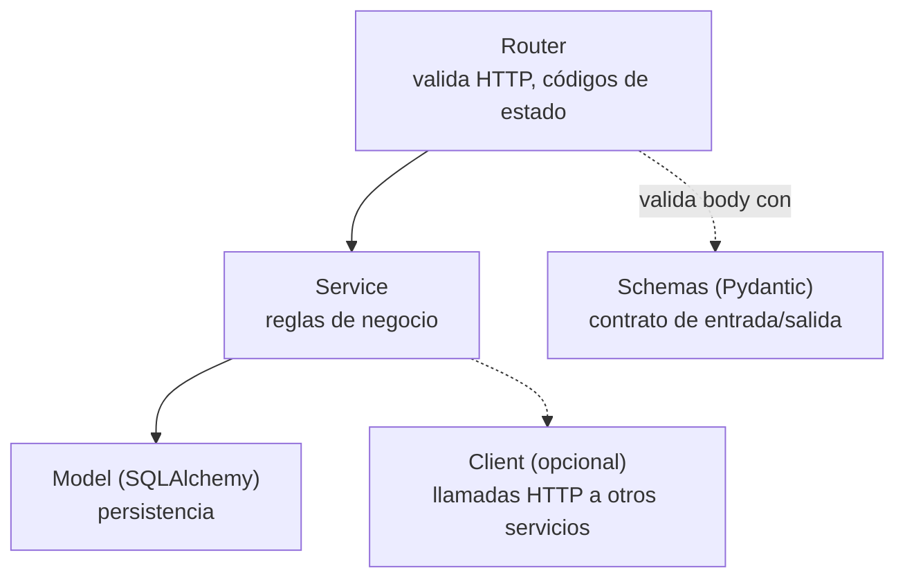
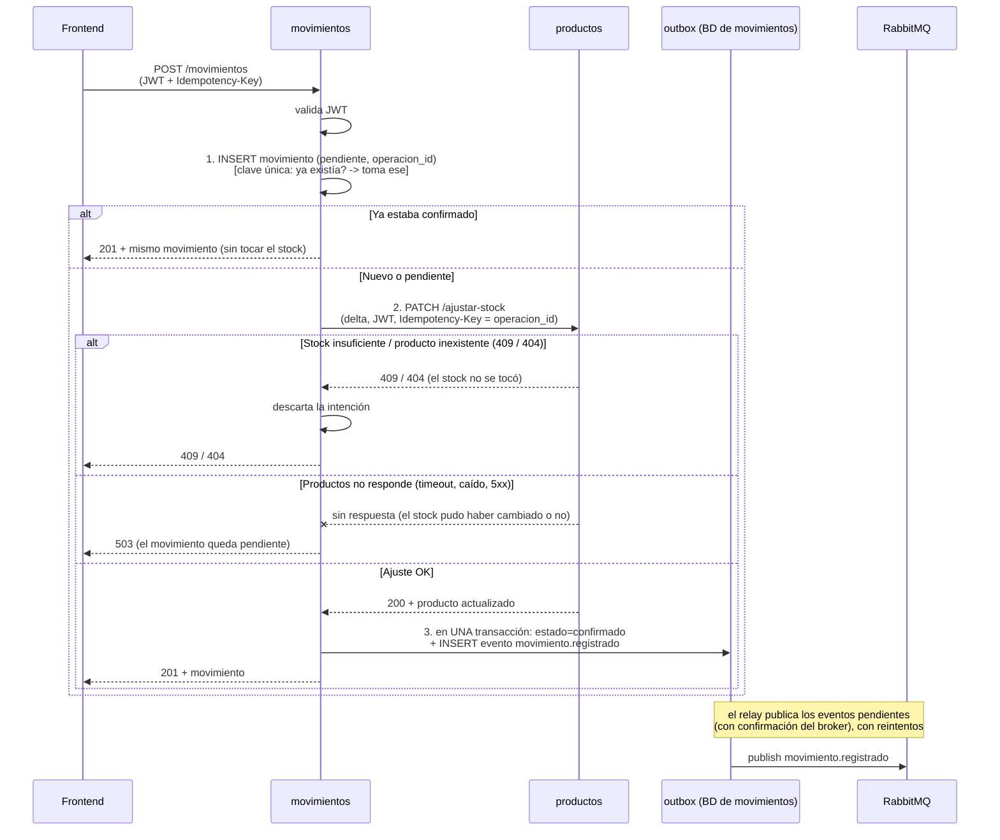
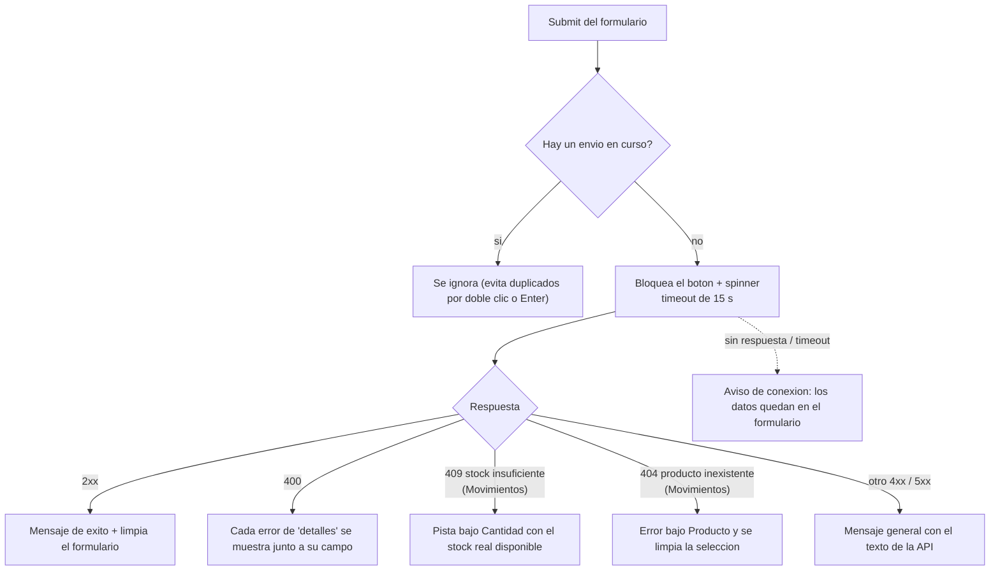
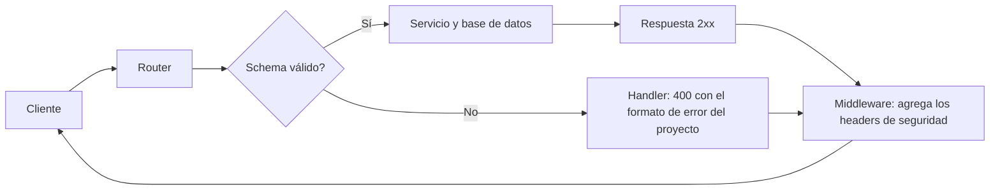
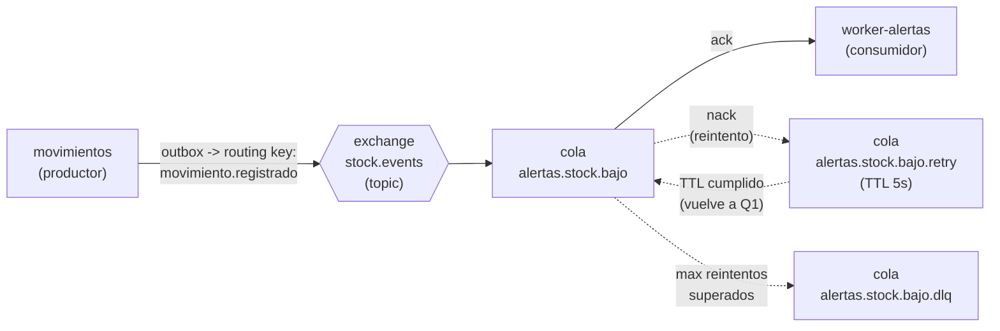
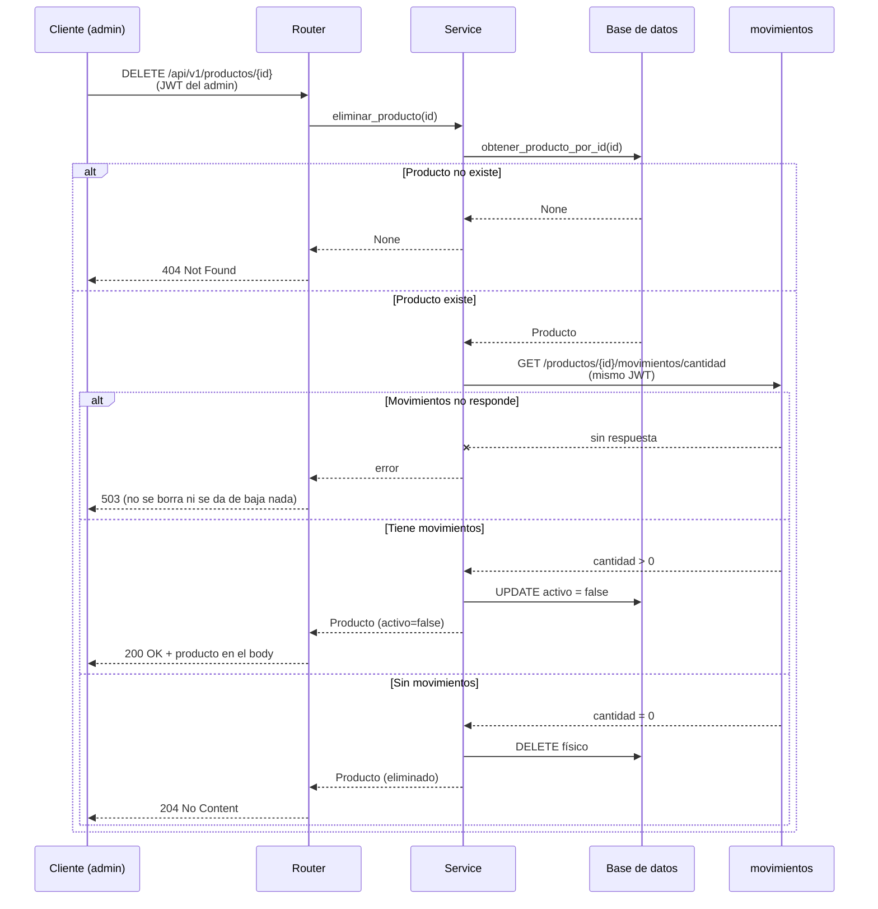

# Arquitectura

## Vista general de servicios

Cada servicio es un proceso independiente con su propio Dockerfile,
dependencias y (cuando corresponde) su propia base de datos:

- **`auth`**: emite y revoca JWT (access + refresh). Es el único que puede
  crear usuarios y firmar tokens. Persiste usuarios en su propia base.
- **`productos`**: dueño del catálogo y del `stock_actual`. Valida JWT
  localmente (mismo `AUTH_SECRET_KEY` que `auth`), consulta Redis para la
  blacklist de tokens revocados, y expone un endpoint atómico e idempotente
  de ajuste de stock que consume `movimientos`. Antes de borrar un producto
  le pregunta a `movimientos` si tiene historial.
- **`movimientos`**: registra el histórico de movimientos (solo inserciones).
  Orquesta la actualización de stock llamando a `productos` por REST
  (nunca lee su base directamente) mediante una saga con recuperación hacia
  adelante, y publica eventos de negocio en RabbitMQ a través de un outbox
  transaccional.
- **`worker-alertas`**: consumidor asíncrono. Escucha el exchange
  `stock.events` y evalúa si corresponde alertar stock bajo
  (`stock_actual <= stock_minimo`). Es idempotente por `id_movimiento`, tiene
  reintentos con backoff + DLQ y expone `GET /health` (puerto 8003).
- **`frontend`**: nginx sirviendo HTML/JS estático (en la ejecución local sin
  Docker lo sirve `python -m http.server`). Genera su `config.js` en runtime a
  partir de variables de entorno. Ver la sección "Frontend: validación,
  errores y envíos" más abajo.

## Capas dentro de un servicio

Todos los servicios backend siguen el mismo patrón de capas:

El router nunca accede a la base de datos directamente: siempre pasa por el
`Service`. Esto mantiene la lógica de negocio en un único lugar, testeable
de forma aislada del framework HTTP.

## Comunicación síncrona vs. asíncrona

El sistema usa **ambos** estilos de comunicación, cada uno donde corresponde:

| Tipo | Entre | Mecanismo | Por qué |
|---|---|---|---|
| **Síncrona** | `movimientos` → `productos` | REST (`PATCH /ajustar-stock`) | El movimiento no puede considerarse exitoso si el stock no se ajustó. La respuesta HTTP lleva el resultado (200/409) y el cliente espera. |
| **Asíncrona** | `movimientos` → `worker-alertas` | RabbitMQ (`movimiento.registrado`) | La alerta de stock bajo no bloquea la respuesta al usuario. El evento se guarda primero en un outbox (misma transacción que confirma el movimiento) y un relay lo publica: si RabbitMQ o el worker están caídos, el evento espera y se procesa cuando vuelvan. |

Regla general: **lo que necesita respuesta inmediata es síncrono; lo que
puede esperar o es tolerante a fallos es asíncrono.**

## Flujo de `POST /api/v1/movimientos`

Registrar un movimiento toca dos bases de datos de servicios distintos, así
que no hay una transacción que las abarque. Se resuelve con una **saga de
"intención primero"**: se guarda el movimiento como `pendiente`, se ajusta el
stock con una clave de operación (idempotente en `productos`) y recién entonces
se confirma, junto con su evento en el outbox.

**Cómo se recupera cada falla**

| Falla | Qué queda | Cómo se resuelve |
|---|---|---|
| `productos` rechaza (404/409) | Nada: la intención se descarta | No hace falta |
| `productos` no responde o la respuesta se pierde | Movimiento `pendiente`; el stock pudo haber cambiado | Reintento con la misma clave (el ajuste es idempotente: aplica ahora o responde que ya estaba aplicado) o reconciliación de un admin |
| Falla el guardado del paso 3 | Stock ya ajustado y movimiento `pendiente` | Igual que arriba: se avanza hasta confirmar. No se "deshace" el stock |
| RabbitMQ caído | Movimiento `confirmado` con su evento en el outbox sin publicar | El relay reintenta con backoff y publica cuando el broker vuelve; sobrevive a reinicios |

**Reconciliación** (`POST /api/v1/movimientos/reconciliar`, solo admin): para
cada pendiente con cierta antigüedad consulta a `productos`
(`GET /api/v1/productos/ajustes/{clave}`) si la operación se aplicó. Si se
aplicó, **confirma**; si no, **descarta**. **Nunca vuelve a ajustar el stock**,
para no ejecutar por sorpresa algo que el usuario abandonó. Usa el token del
admin porque los servicios no tienen credenciales propias.

**La idempotencia es atómica**: la `Idempotency-Key` se guarda en `movimientos`
con un índice único, así que dos pedidos simultáneos con la misma clave no
pueden crear dos movimientos. Reutilizarla con otro contenido da `422`.
Además, `productos` guarda la clave del ajuste en la misma transacción que
cambia el stock (tabla `ajustes_stock`).

**Quién genera la `Idempotency-Key`**: el frontend (un UUID por intento de
registro). Si el intento termina sin respuesta definitiva (timeout, corte de
red, 5xx o 401) y los datos del formulario no cambiaron, el reintento reutiliza
la **misma** clave; con una respuesta definitiva o con datos distintos se genera
una clave nueva. Así un reintento nunca descuenta el stock dos veces.

## Frontend: validación, errores y envíos

El frontend (`frontend/app.js` para Inventario y `frontend/movimientos.js`
para Movimientos, que comparten el mismo scope) concentra la experiencia de
usuario del formulario. Cada envío sigue este flujo:

Decisiones de diseño:

- **Errores 400 por campo**: el backend devuelve en `detalles` la lista de
  errores de Pydantic (`loc`, `type`, `ctx`). El frontend traduce cada `type`
  a un mensaje en español (`traducirErrorValidacion`), lo muestra bajo el
  campo, marca el campo con `aria-invalid` y enfoca el primero. El error se
  borra apenas el usuario corrige ese campo.
- **Anti-duplicados**: una bandera por formulario ignora envíos mientras hay
  una petición en curso, y el botón se bloquea con un spinner. Esta barrera
  protege solo a la pestaña actual.
- **Fallas de red**: toda petición del formulario tiene un tiempo máximo de
  espera de 15 s (`AbortController`). Al crear un producto, si no hay
  respuesta, el mensaje advierte que no se puede confirmar si se guardó y
  pide revisar el inventario antes de reintentar, porque `POST /productos` no
  es idempotente en el backend.
- **Ayuda al usuario**: cada campo tiene un texto de ayuda con su regla y un
  ejemplo, un tooltip ("?") con la explicación de qué se ingresa, y cada
  pantalla una guía desplegable con un botón que completa el formulario con
  un ejemplo (sin guardar nada).
- **Sesión**: `apiFetch` agrega el JWT, renueva el access token con el
  refresh token ante un 401 y, si la renovación falla, vuelve al login. Los
  tokens se guardan en `localStorage`.

## Seguridad de entrada y encabezados

`productos` y `movimientos` filtran lo que entra y marcan todo lo que sale.
La validación vive en los schemas de Pydantic, antes de tocar la base de
datos o llamar a otro servicio; los headers los agrega un middleware.

- **Validación de entrada.** `productos` rechaza en nombre, marca y categoría
  los caracteres `<` `>` `;` `=` `{` `}` `\`, el acento grave y los de control;
  `movimientos` exige que los DNI sean de 1 a 8 dígitos. El filtro es una
  capa adicional: la defensa principal contra la inyección SQL son las
  consultas con parámetros enlazados de SQLAlchemy. En `productos` se
  aplica solo a los schemas de entrada (`ProductoEntrada`), no a
  `ProductoOut`, para que un dato guardado antes del filtro no rompa un `GET`.
- **Headers.** `X-Content-Type-Options: nosniff` (anti-sniffing),
  `X-Frame-Options: DENY` y `Content-Security-Policy: frame-ancestors 'none'`
  (anti-clickjacking) en **toda** respuesta, errores incluidos.
- **El `500` inesperado es un caso aparte.** Lo arma la capa más externa de
  Starlette, por fuera de los middlewares, así que el middleware no lo
  alcanza. Por eso el handler de excepciones recibe los headers de forma
  explícita. Un test fuerza una falla interna y verifica que el `500` también
  los lleve.
- **Alcance.** `auth` y el frontend (nginx) todavía no definen estos headers.

Los tests de esta sección están en `tests/test_bateria_minima.py` de cada
servicio (ver "Batería de carga y blindaje de endpoints" en el `README.md`
raíz).

## Ejecución local sin Docker (`ejecutar_local.ps1`)

Para Windows existe un script que levanta el sistema sin Docker. Cada
servicio corre en su propia ventana de PowerShell con su propio entorno
virtual (Python 3.10 a 3.13):

| Componente | Puerto | En modo local |
|---|---|---|
| `auth` | 8001 | Sí |
| `productos` | 8000 | Sí |
| `movimientos` | 8002 | Sí (usa `productos` por HTTP) |
| `frontend` | 8080 | Sí (`python -m http.server`) |
| Redis | - | Reemplazado por `fakeredis` (`REDIS_URL=memory://`), uno por proceso; `productos` y `movimientos` consultan a `auth` si un token fue revocado |
| RabbitMQ y `worker-alertas` | - | **No corren** |

Consecuencias de no tener RabbitMQ: los movimientos se registran con
normalidad y su evento queda guardado en el outbox de `movimientos` (el relay
que lo publicaría está desactivado en este modo), y por lo tanto no se procesan
alertas de stock bajo.

El logout **sí** invalida el token en los tres servicios: como cada uno tiene su
propio Redis en memoria, `productos` y `movimientos` le preguntan a `auth`
(`GET /api/v1/auth/tokens/{jti}/revocado`, habilitado solo con
`HABILITAR_CONSULTA_REVOCACION=true`) si el token fue revocado. Es una llamada
HTTP extra por request, solo en este modo; si `auth` no responde se deja pasar
el token (mismo criterio fail-open que con Redis).

Además del modo normal, el script prepara y corre los tests sin Docker, sin
Redis real y sin activar entornos virtuales a mano:

| Opción | Qué hace |
|---|---|
| (ninguna) | Levanta el sistema y abre el navegador |
| `-Tests` | Corre los tests de `auth`, `productos`, `movimientos` y `worker-alertas` y muestra un resumen; no levanta nada |
| `-Bateria` | Corre solo la batería de carga, sanitización y headers de `productos` y `movimientos` |
| `-Todo` | Corre todos los tests y, si pasan, levanta el sistema |

Cada servicio usa el Python de su propio entorno (`venv`), con las
dependencias de test incluidas (`requirements-dev.txt` en `auth` y
`productos`). La suite de `auth` corre con `REDIS_URL=memory://`.

## Flujo del evento `movimiento.registrado`

El evento es **autocontenido**: incluye `stock_actual`, `stock_minimo` y
`nombre_producto` al momento del movimiento. El worker no necesita llamar a
`productos` (que además exige JWT de usuario, y el worker no lo tiene). Ver
`services/movimientos/EVENTOS.md` para el catálogo completo.

## Flujo de `DELETE /api/v1/productos/{id}`

`tiene_movimientos_asociados` consulta de verdad a `movimientos` por su API
REST (cuenta movimientos confirmados y pendientes) con el token del admin que
hace la baja. Si `movimientos` no responde, la operación **falla cerrada**
(503): no se supone "sin historial", porque eso llevaría a borrar físicamente un
producto con movimientos. La consulta y el borrado no forman una transacción
(son servicios distintos): un movimiento registrado en los milisegundos entre
ambos pasos no se vería. `productos` llama a `movimientos` solo en tiempo de
ejecución; en `docker-compose.yml` no hay `depends_on` en esa dirección para no
crear un ciclo.

## Decisión de persistencia

Cada servicio es dueño de sus datos:

- `productos` → base propia con el catálogo, `stock_actual` y los ajustes aplicados con clave de idempotencia.
- `movimientos` → base propia con el histórico, las claves de idempotencia y el outbox de eventos.
- `worker-alertas` → base propia (SQLite local) solo para idempotencia.

**Ningún servicio accede directamente a la base de otro.** Toda
comunicación entre servicios es vía API REST o eventos. Ver
`services/productos/README.md`, sección "Persistencia", para la
justificación de SQLite en esta etapa y qué cambiaría para migrar a
Postgres.

## Concurrencia en el ajuste de stock

`POST /movimientos` puede recibir múltiples requests concurrentes sobre el
mismo producto (dos ventas simultáneas, por ejemplo). Un ajuste "leer →
validar en Python → escribir" permite sobreventa.

La solución implementada está en `productos`: el endpoint
`PATCH /api/v1/productos/{id}/ajustar-stock` evalúa la condición de stock
dentro de la propia sentencia `UPDATE ... WHERE stock_actual >= n`, así que
la base resuelve la carrera atómicamente. Ver el `README.md` raíz, sección
"Concurrencia", para el detalle del problema, el mecanismo y los tests.

## Limitaciones del sistema (resumen)

Cada servicio documenta sus propias limitaciones en detalle en su README.
A nivel de sistema completo, las más relevantes hoy son:

- **SQLite en lugar de un motor cliente-servidor**: adecuado para la etapa
  actual del proyecto, pero limita la concurrencia real y la separación
  física de datos. Migrar a Postgres es un cambio acotado (la capa de
  SQLAlchemy está aislada en `database/db.py` de cada servicio). Además, el
  relay del outbox está pensado para **una sola instancia** de `movimientos`
  escribiendo su base.
- **Los movimientos `pendiente` necesitan un reintento o una reconciliación
  manual**: no hay un proceso automático que los resuelva porque los servicios
  no tienen credenciales propias (un reintento usa el token del usuario; la
  reconciliación, el de un admin). Hasta entonces el stock puede estar ya
  ajustado con el movimiento todavía sin confirmar; el historial lo muestra
  con estado `pendiente`.
- **Ventana residual al reconciliar**: si un pendiente de más de 5 minutos se
  descarta por no haberse aplicado en el mismo instante en que el cliente lo
  reintenta, el stock podría cambiar sin que quede movimiento. Cerrarlo del
  todo exigiría poder cancelar la clave en `productos`.
- **Baja de producto no atómica con la consulta a `movimientos`**: ver el flujo
  de `DELETE` más arriba.
- **Entrega at-least-once**: un evento puede publicarse más de una vez (si el
  proceso cae entre publicar y marcarlo); el worker es idempotente por
  `id_movimiento`. Si ninguna cola está enlazada al exchange (el worker nunca
  arrancó), los eventos se acumulan en el outbox en lugar de perderse.
- **Eventos de movimientos reconciliados** llevan el stock actual del producto,
  no el del instante del movimiento (no se conserva).
- **`POST /productos` no tiene idempotencia**: en esa pantalla el frontend solo
  bloquea el botón y avisa ante fallas de red.
- **Pool de conexiones por defecto**: SQLAlchemy abre hasta 15 conexiones
  por servicio (5 más 10 de desborde). En una prueba local con 150 ventas
  simultáneas y stock suficiente, `productos` dejó sin respuesta a la mayoría
  de las peticiones (`QueuePool limit of size 5 overflow 10 reached`);
  con `pool_size=20` y `max_overflow=60` en `create_engine` se resolvieron
  todas. Ese ajuste todavía no está aplicado, y la prueba de 20 peticiones
  de la batería no llega a exponerlo.
- **Seguridad pensada para desarrollo**: CORS abierto (`allow_origins=["*"]`)
  en los tres servicios, tokens guardados en `localStorage`, JWT firmados con
  un secreto compartido (HS256) y credenciales por defecto (RabbitMQ y
  usuarios de prueba) documentadas. Sí hay validación de entrada y headers
  de seguridad en `productos` y `movimientos` (ver "Seguridad de entrada y
  encabezados"); `auth` y el frontend todavía no los tienen.
- **Modo local sin Docker** (`ejecutar_local.ps1`): sin RabbitMQ ni worker (los
  eventos quedan en el outbox), con un Redis en memoria por servicio. El logout
  sí es efectivo (se consulta a `auth`), a costa de una llamada HTTP por request;
  el estado en memoria de `auth` (bloqueo por intentos de login, rotación de
  refresh tokens) se pierde al reiniciar el servicio.
- **El frontend no tiene tests automáticos.**
