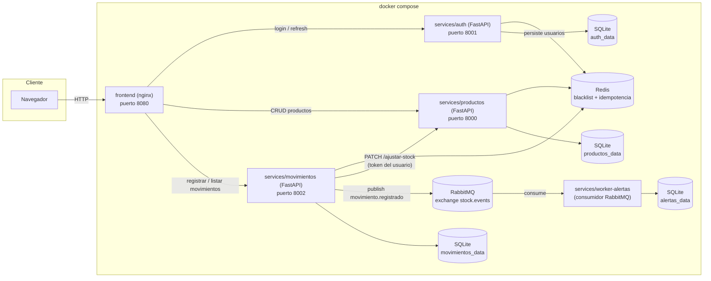
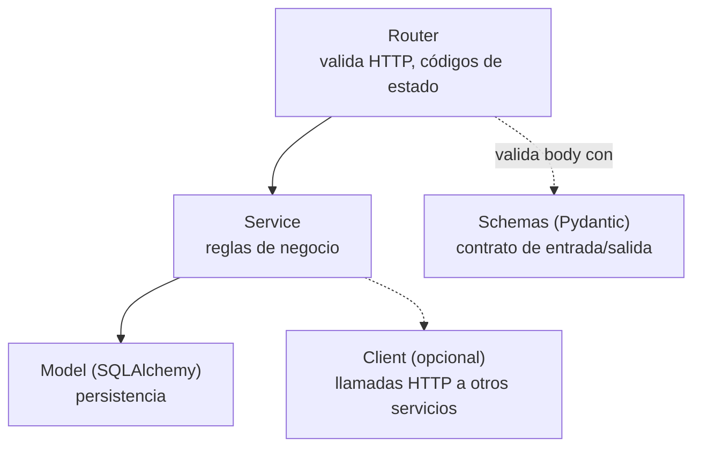
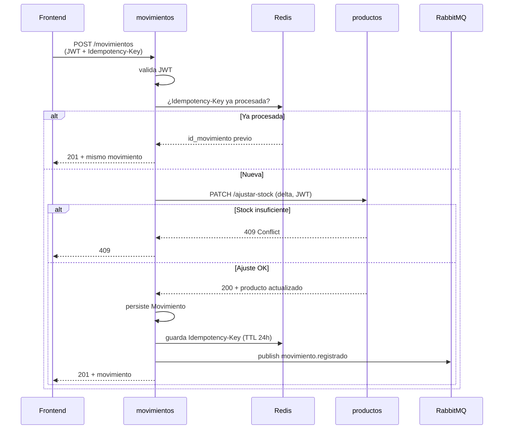
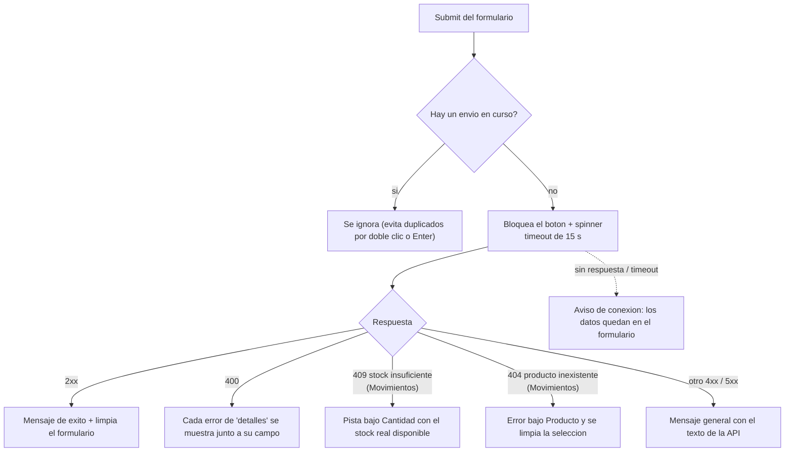
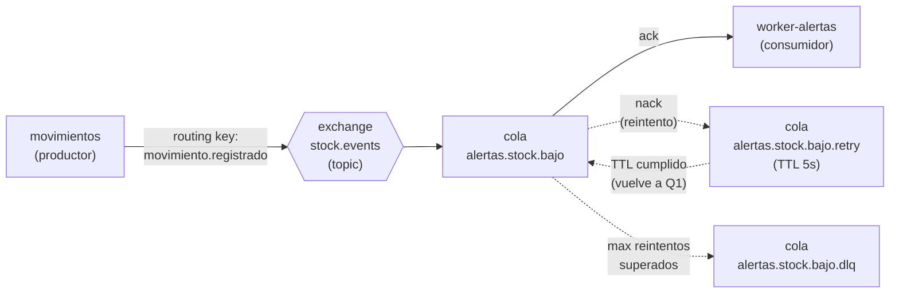
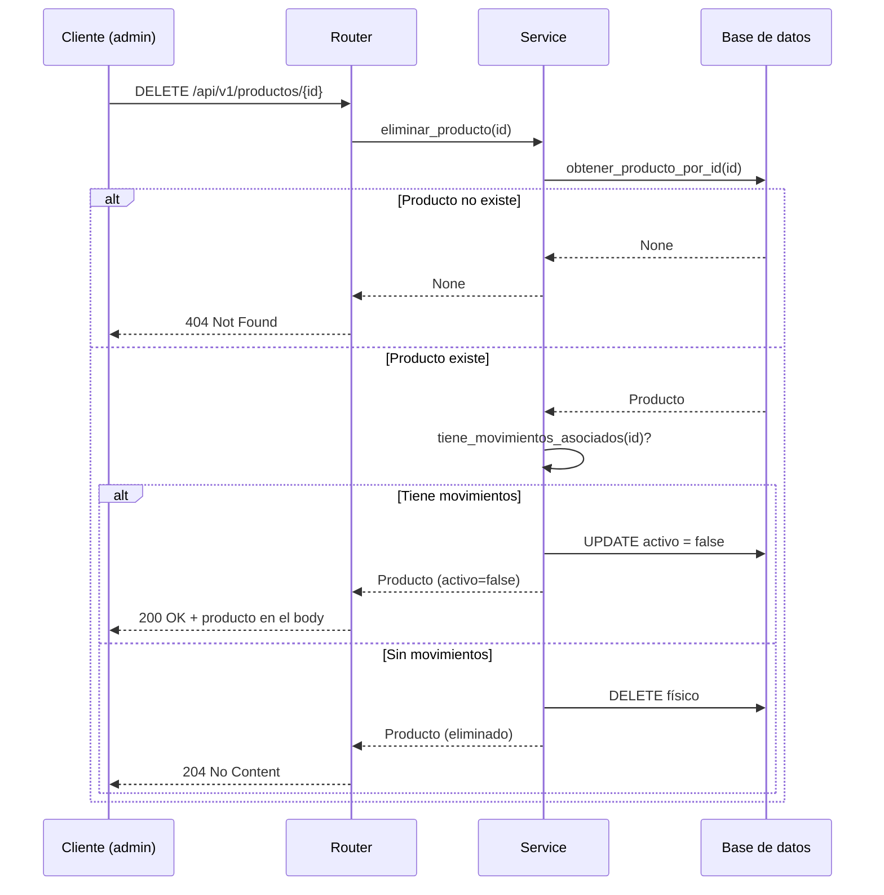

# Arquitectura

## Vista general de servicios

Cada servicio es un proceso independiente con su propio Dockerfile,
dependencias y (cuando corresponde) su propia base de datos:

- **`auth`**: emite y revoca JWT (access + refresh). Es el único que puede
  crear usuarios y firmar tokens. Persiste usuarios en su propia base.
- **`productos`**: dueño del catálogo y del `stock_actual`. Valida JWT
  localmente (mismo `AUTH_SECRET_KEY` que `auth`), consulta Redis para la
  blacklist de tokens revocados, y expone un endpoint atómico de ajuste de
  stock que consume `movimientos`.
- **`movimientos`**: registra el histórico de movimientos (solo inserciones).
  Orquesta la actualización de stock llamando a `productos` por REST
  (nunca lee su base directamente). Publica eventos de negocio en RabbitMQ.
- **`worker-alertas`**: consumidor asíncrono. Escucha el exchange
  `stock.events` y evalúa si corresponde alertar stock bajo. Es idempotente
  por `id_movimiento` y tiene reintentos con backoff + DLQ.
- **`frontend`**: nginx sirviendo HTML/JS estático (en la ejecución local sin
  Docker lo sirve `python -m http.server`). Genera su `config.js` en runtime a
  partir de variables de entorno. Ver la sección "Frontend: validación,
  errores y envíos" más abajo.

## Capas dentro de un servicio

Todos los servicios backend siguen el mismo patrón de capas:

El router nunca accede a la base de datos directamente: siempre pasa por el
`Service`. Esto mantiene la lógica de negocio en un único lugar, testeable
de forma aislada del framework HTTP.

## Comunicación síncrona vs. asíncrona

El sistema usa **ambos** estilos de comunicación, cada uno donde corresponde:

| Tipo | Entre | Mecanismo | Por qué |
|---|---|---|---|
| **Síncrona** | `movimientos` → `productos` | REST (`PATCH /ajustar-stock`) | El movimiento no puede considerarse exitoso si el stock no se ajustó. La respuesta HTTP lleva el resultado (200/409) y el cliente espera. |
| **Asíncrona** | `movimientos` → `worker-alertas` | RabbitMQ (`movimiento.registrado`) | La alerta de stock bajo no bloquea la respuesta al usuario. Si el worker está caído, el evento queda encolado y se procesa cuando vuelva. |

Regla general: **lo que necesita respuesta inmediata es síncrono; lo que
puede esperar o es tolerante a fallos es asíncrono.**

## Flujo de `POST /api/v1/movimientos`

Si RabbitMQ está caído, el evento no se publica pero el movimiento **sí**
queda persistido: la respuesta al usuario no se bloquea por una falla de
mensajería (se loguea y sigue).

**Quién genera la `Idempotency-Key`**: el frontend (un UUID por intento de
registro). Si el intento termina sin respuesta definitiva (timeout, corte de
red o 5xx) y los datos del formulario no cambiaron, el reintento reutiliza la
**misma** clave; con una respuesta definitiva (< 500) o con datos distintos se
genera una clave nueva. Así, un reintento tras un timeout no descuenta el
stock dos veces *si el primer intento llegó a registrar la clave* (ver
limitaciones).

## Frontend: validación, errores y envíos

El frontend (`frontend/app.js` para Inventario y `frontend/movimientos.js`
para Movimientos, que comparten el mismo scope) concentra la experiencia de
usuario del formulario. Cada envío sigue este flujo:

Decisiones de diseño:

- **Errores 400 por campo**: el backend devuelve en `detalles` la lista de
  errores de Pydantic (`loc`, `type`, `ctx`). El frontend traduce cada `type`
  a un mensaje en español (`traducirErrorValidacion`), lo muestra bajo el
  campo, marca el campo con `aria-invalid` y enfoca el primero. El error se
  borra apenas el usuario corrige ese campo.
- **Anti-duplicados**: una bandera por formulario ignora envíos mientras hay
  una petición en curso, y el botón se bloquea con un spinner. Esta barrera
  protege solo a la pestaña actual.
- **Fallas de red**: toda petición del formulario tiene un tiempo máximo de
  espera de 15 s (`AbortController`). Al crear un producto, si no hay
  respuesta, el mensaje advierte que no se puede confirmar si se guardó y
  pide revisar el inventario antes de reintentar, porque `POST /productos` no
  es idempotente en el backend.
- **Ayuda al usuario**: cada campo tiene un texto de ayuda con su regla y un
  ejemplo, un tooltip ("?") con la explicación de qué se ingresa, y cada
  pantalla una guía desplegable con un botón que completa el formulario con
  un ejemplo (sin guardar nada).
- **Sesión**: `apiFetch` agrega el JWT, renueva el access token con el
  refresh token ante un 401 y, si la renovación falla, vuelve al login. Los
  tokens se guardan en `localStorage`.

## Ejecución local sin Docker (`ejecutar_local.ps1`)

Para Windows existe un script que levanta el sistema sin Docker. Cada
servicio corre en su propia ventana de PowerShell con su propio entorno
virtual (Python 3.10 a 3.13):

| Componente | Puerto | En modo local |
|---|---|---|
| `auth` | 8001 | Sí |
| `productos` | 8000 | Sí |
| `movimientos` | 8002 | Sí (usa `productos` por HTTP) |
| `frontend` | 8080 | Sí (`python -m http.server`) |
| Redis | - | Reemplazado por `fakeredis` (`REDIS_URL=memory://`), uno por proceso |
| RabbitMQ y `worker-alertas` | - | **No corren** |

Consecuencias de no tener RabbitMQ: los movimientos se registran con
normalidad, pero la publicación del evento falla y queda solo como error en el
log de `movimientos` (el `201` no se ve afectado), y por lo tanto no se
procesan alertas de stock bajo. Consecuencias del Redis en memoria: ver la
última limitación de la lista siguiente.

## Flujo del evento `movimiento.registrado`

El evento es **autocontenido**: incluye `stock_actual`, `stock_minimo` y
`nombre_producto` al momento del movimiento. El worker no necesita llamar a
`productos` (que además exige JWT de usuario, y el worker no lo tiene). Ver
`services/movimientos/EVENTOS.md` para el catálogo completo.

## Flujo de `DELETE /api/v1/productos/{id}`

Nota: el método `tiene_movimientos_asociados` en `productos` sigue siendo un
placeholder (`return False`) — la integración real con `movimientos`
consultaría su API o compartiría un evento. Queda documentado como deuda
técnica.

## Decisión de persistencia

Cada servicio es dueño de sus datos:

- `productos` → base propia con el catálogo y `stock_actual`.
- `movimientos` → base propia con el histórico.
- `worker-alertas` → base propia (SQLite local) solo para idempotencia.

**Ningún servicio accede directamente a la base de otro.** Toda
comunicación entre servicios es vía API REST o eventos. Ver
`services/productos/README.md`, sección "Persistencia", para la
justificación de SQLite en esta etapa y qué cambiaría para migrar a
Postgres.

## Concurrencia en el ajuste de stock

`POST /movimientos` puede recibir múltiples requests concurrentes sobre el
mismo producto (dos ventas simultáneas, por ejemplo). Un ajuste "leer →
validar en Python → escribir" permite sobreventa.

La solución implementada está en `productos`: el endpoint
`PATCH /api/v1/productos/{id}/ajustar-stock` evalúa la condición de stock
dentro de la propia sentencia `UPDATE ... WHERE stock_actual >= n`, así que
la base resuelve la carrera atómicamente. Ver el `README.md` raíz, sección
"Concurrencia", para el detalle del problema, el mecanismo y los tests.

## Limitaciones del sistema (resumen)

Cada servicio documenta sus propias limitaciones en detalle en su README.
A nivel de sistema completo, las más relevantes hoy son:

- **`tiene_movimientos_asociados` no está integrado**: el servicio
  `productos` no consulta a `movimientos` para decidir si un producto se
  puede borrar físicamente. Hoy siempre devuelve `False`, así que la baja
  lógica nunca se activa en la práctica.
- **SQLite en lugar de un motor cliente-servidor**: adecuado para la etapa
  actual del proyecto, pero limita la concurrencia real y la separación
  física de datos. Migrar a Postgres es un cambio acotado (la capa de
  SQLAlchemy está aislada en `database/db.py` de cada servicio).
- **`worker-alertas` no tiene healthcheck HTTP**: es un proceso de
  background, se monitorea por logs (`docker compose logs -f
  worker-alertas`). `docker compose ps` no puede mostrar `healthy` para él.
- **Sin pipeline de CI**: los tests existen y pasan localmente, pero
  ejecutarlos es un paso manual. Falta un workflow de GitHub Actions que
  corra `pytest` en cada push.
- **Ajuste de stock y registro del movimiento no son atómicos**:
  `movimientos` primero ajusta el stock en `productos` (HTTP) y recién
  después persiste el movimiento. Si ese guardado falla, o si `productos`
  aplicó el ajuste pero la respuesta no llegó, el stock queda modificado sin
  movimiento y no hay compensación.
- **Idempotencia parcial**: en `movimientos` la `Idempotency-Key` se consulta
  antes y se guarda después (`get` y `set` separados, no `SET NX`), así que
  dos requests simultáneos con la misma clave pueden pasar ambos, y la clave
  solo se registra si el primer intento llegó a completarse. `POST /productos`
  no tiene idempotencia: en esa pantalla el frontend solo bloquea el botón y
  avisa ante fallas de red.
- **Eventos perdidos si RabbitMQ está caído**: el fallo de publicación se
  loguea y no se reintenta (no hay patrón outbox), por lo que esa alerta de
  stock bajo se pierde.
- **Criterio de stock bajo distinto entre UI y worker**: la tabla de
  Inventario marca "stock bajo" con `stock_actual <= stock_minimo`, mientras
  que `worker-alertas` solo alerta con `stock_actual < stock_minimo`. Con el
  stock igual al mínimo la UI lo marca y no se genera alerta.
- **Seguridad pensada para desarrollo**: CORS abierto (`allow_origins=["*"]`)
  en los tres servicios, tokens guardados en `localStorage`, JWT firmados con
  un secreto compartido (HS256) y credenciales por defecto (RabbitMQ y
  usuarios de prueba) documentadas.
- **`fakeredis` en modo local**: cuando se corre sin Docker
  (`ejecutar_local.ps1`), `auth`, `productos` y `movimientos` usan cada uno su
  propio `fakeredis` (Redis en memoria por proceso). Al hacer logout, `auth`
  revoca el access token y el refresh token en su Redis, así que `auth` los
  rechaza, pero `productos` y `movimientos` consultan el suyo (vacío) y siguen
  aceptando ese access token hasta que expira (15 min). Con `docker compose`,
  que usa un Redis compartido, el token queda revocado en los tres servicios.
  Además, el estado en memoria (bloqueo por intentos de login, rotación de
  refresh tokens, idempotencia de movimientos) se pierde al reiniciar el
  servicio.
